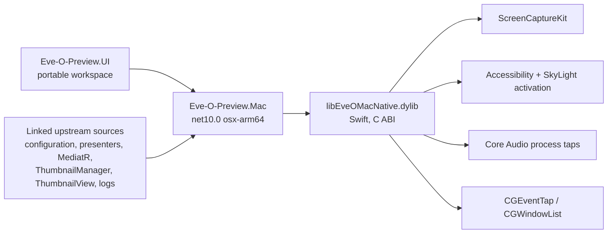

# macOS port

The `macos-port` branch of the bandstacker fork adds a macOS host for the native Apple Silicon EVE client. It reuses the portable workspace UI, configuration, presenters, MediatR handlers, `ThumbnailManager`, `ThumbnailView`, combat-log/static-data services and preview/overlay contracts, and supplies macOS implementations of the Windows host services. Upstream files keep their behavior on Windows; the few shared edits are listed under [Upstream seams](#upstream-seams) so `upstream/main` merges stay small.

User-facing setup and feature notes are in [README.macOS.md](../../../README.macOS.md).

## Product decisions

| Area | Decision |
| --- | --- |
| Audience | Personal use first, packaged so it can be shared later (GPL-3, public fork). |
| Stack | C# .NET 10 + Avalonia (the same UI as Windows) and a Swift dynamic library (`libEveOMacNative`) for ScreenCaptureKit, Accessibility, window-server activation, Core Audio taps, event taps and process policy. |
| EVE client | Native macOS client, windowed, all clients on one Space. Native fullscreen Spaces are out of scope. |
| UI gaps | Controls macOS cannot implement are hidden; macOS equivalents replace them on the same pages. |
| FPS | No FPS limiting (no injection, no suspend/resume throttling). |
| Audio | Whole-client mute of background clients through Core Audio process taps (macOS 14.2+). Selective Wwise event muting needs injection and is hidden. |
| CPU | Background clients enter Darwin background policy (efficiency cores, lowest priority, throttled disk I/O). The active client, the predicted next client and login screens are exempt, and a client is released when its window disappears, so reconnect sockets are never created throttled. Sockets opened before entering background are unaffected (`setpriority(2)`). |
| Profiles | Identical JSON format under `~/Library/Application Support/EVE-O Preview/`, plus an importer for Windows profile folders that rescales geometry. |
| Modifiers | Command is the persisted `Ctrl` modifier, Option is `Alt`, Shift is `Shift`; Control maps to Win and never matches a shortcut. Profiles move between platforms unchanged, and preview gestures follow (Command-click hides a client). |
| Minimize | "Minimize" hides the client process (instant, per client). Other applications use a real window minimize. |
| Presence | Menu-bar item only (`LSUIElement`). Reopening the app (Finder, Spotlight) shows settings, because a crowded menu bar can hide the item behind the camera housing. |
| Signing | Local self-signed `EVE-O Preview Dev` identity so TCC grants survive rebuilds. Developer ID and notarization are a later step for sharing. |
| Preview rate | macOS setting `PreviewFrameRate`, 1-60 FPS, default 15, captured at the preview's backing resolution. |
| Minimum OS | macOS 14.2. |

## Architecture



- [Eve-O-Preview.Mac.csproj](../../Eve-O-Preview.Mac/Eve-O-Preview.Mac.csproj) compiles every upstream host source by link (`Upstream/...`) except the `UpstreamWindowsOnly` list (Win32 interop, DWM, Robin, CPU sets, debugger sidecar, Windows input, GDI renderers and the Windows `WorkspaceWindow`). When upstream adds a Windows-only file that the macOS build cannot compile, add it to that list and supply a macOS counterpart only if shared code references it.
- Windows-only types referenced directly by shared views have macOS implementations with the same public surface in [Compat/](../../Eve-O-Preview.Mac/Compat/): `WindowsPreviewWindowAdapter`, `User32NativeMethods` (the five calls `ThumbnailView` makes), `CompatibilityOverlayRenderer` (wraps the portable `AvaloniaPreviewOverlay`) and a throwing `NativeCompositionOverlayRenderer`. A changed upstream surface fails the macOS build at compile time.
- [Eve-O-Preview.Mac.Native](../../Eve-O-Preview.Mac.Native/) is a SwiftPM package with a flat C ABI (`@_cdecl`, `eom_*`). [MacNative.cs](../../Eve-O-Preview.Mac/Native/MacNative.cs) binds it with `LibraryImport`. Callbacks from native threads post to the Avalonia UI thread.
- [MacProgram.cs](../../Eve-O-Preview.Mac/MacProgram.cs) mirrors upstream `Program.CreateApplicationContainerBuilder` with macOS registrations and configures the shared settings catalog for the platform.

### Identity and geometry

| Windows concept | macOS value |
| --- | --- |
| Source HWND (`IThumbnailView.Id`, `IProcessInfo.MainWindowHandle`) | `CGWindowID` of the client's main window, as `IntPtr` |
| Preview/overlay HWND | `NSWindow*` (normalized from Avalonia's platform handle) |
| Process handle | PID (no kernel handle exists) |
| `ProcessName == "ExeFile"` | EVE client processes report `ExeFile`, so shared EVE-only routes apply |
| Preview pixels | Global Quartz points, top-left origin. Avalonia reports macOS window positions and screen bounds in points, so `PreviewPixels.AreDips = true` makes one preview pixel one DIP. Live capture still renders at the backing resolution. |

Own NSWindow pointers are always above the 32-bit range on arm64; `User32NativeMethods` and `MacWindowManager` use that to tell them apart from window IDs.

### Service mapping

| Upstream service | macOS implementation |
| --- | --- |
| `IProcessMonitor` / `IProcessInfo` | `MacProcessMonitor`: `CGWindowListCopyWindowInfo` layer-0 windows of EVE clients and selected applications, one stable main window per process, Accessibility title fallback. |
| `IWindowManager` | `MacWindowManager`: `_SLPSSetFrontProcessWithOptions` plus a key-window event record (as window switchers do; about 3-5 ms), then Accessibility raise off the caller's thread; hide/unhide for EVE clients; AX frame get/set for client layouts. |
| `IDwmThumbnail` | `MacLiveThumbnail`: one ScreenCaptureKit stream per source. IOSurface frames are assigned to a pass-through layer view above the preview window's content (DWM-like, no CPU copy). Window capture keeps the source aspect ratio inside the buffer, so the layer's `contentsRect` selects the reported content rectangle and stretches it like DWM. |
| `ForegroundWindowObserver` | Same name: application-activation notifications report the focused client window. |
| `IHotkeyService` | `MacHotkeyService`: suppressing `CGEventTap` feeding the upstream `WindowsHotkeyMatcher` (Mac key codes mapped to Windows virtual keys). Requires Accessibility. |
| `IGlobalPointerInput` | `MacGlobalPointerInput`: listen-only pointer tap. A global mouse-up is delivered only to handlers subscribed before it occurred, reproducing the Windows hook's ordering (otherwise a menu action that starts move mode would receive its own click's release). |
| `IHookService` + `ICpuAffinityService` | `MacClientPolicyService`: background policy and background mute per PID; FPS and selective mute report unsupported. |
| `IWorkspacePreviewCapture` | `MacWorkspacePreviewCapture`: `SCScreenshotManager` still. |
| `IWorkspacePreviewRenderer` | `WindowsWorkspacePreviewRenderer` (same name): portable overlay rendered with `RenderTargetBitmap` at the main display's backing scale. |
| Settings window and tray | macOS `WorkspaceWindow` (same shared `WorkspaceView`, no Windows session/DWM handling) with an Avalonia `TrayIcon` (`NSStatusItem`) and a `macOS` workspace module (permissions, Windows import, title-bar crop). |
| Character account IDs | `MacEveClientUserIdReader`: launcher arguments through `KERN_PROCARGS2`, parsed by upstream `EveClientUserIdReader.ExtractUserId`. |

### macOS settings

Stored in `EVE-O Preview.macos.json` beside the global settings file and bound through `WindowsWorkspaceBackend.BuildPlatformSettings`:

| Key | Page | Meaning |
| --- | --- | --- |
| `PreviewFrameRate` | Performance & audio | Live preview FPS, 1-60 (default 15). |
| `AudioMuteBackgroundClients` | Performance & audio | Mute every EVE client except the active one. |
| `MacTitleBarCrop` | macOS | Points cropped from the top of each captured client window. |

`EnableAutomaticCpuAffinity` keeps its profile key and is relabelled "Efficiency cores for background clients". Hidden on macOS: `HotkeyInputMethod`, `EnableCompatibilityMode`, `PreviewOverlayRenderer`, all `Fps*` keys and the three selective audio keys.

## Upstream seams

Each seam is a small, platform-guarded edit. Keep this list current and rebase them over upstream changes.

| File | Seam |
| --- | --- |
| `Eve-O-Preview.UI/SettingCatalog.cs` | `All` returns a platform list configured once with `ConfigurePlatform(supported, overrides)`. |
| `Eve-O-Preview.UI/Previews/PreviewPixels.cs` (new) | Preview pixels per DIP; `AreDips` is false on Windows. |
| `Eve-O-Preview.UI/Previews/AvaloniaPreviewOverlay.cs` | Render scale through `PreviewPixels.PerDip`. |
| `Eve-O-Preview.UI/WorkspaceView.AdvancedSettings.cs` | Preview graphics editor and compatibility-capture toggle only when their settings exist. |
| `Eve-O-Preview.UI/WorkspaceView.Pages.cs` | Overview card and Performance headings without frame limits when `FpsEnabled` is absent. |
| `View/Implementation/ThumbnailView.cs`, `ThumbnailView.Regions.cs`, `ThumbnailRegionWindow.cs`, `ThumbnailSnapGuideWindow.cs` | Pixel/DIP conversions through `PreviewPixels.PerDip`. |
| `View/Implementation/WindowsWorkspaceBackend.cs` | `partial void BuildPlatformSettings()`; font validation without GDI+ off Windows. |
| `View/CustomControl/NativeMenuTheme.cs` | High-contrast query only on Windows. |
| `Services/Logs/CompleteLogReader.cs` | macOS file identity: path plus birth time. |
| `Services/Logs/CombatLogService.cs` | macOS follows each listener's newest Gamelog with the existing 250 ms length probe, because FSEvents coalesces appends to files that stay open. |

## Build, run and test

```bash
cd src
dotnet publish Eve-O-Preview.Mac/Eve-O-Preview.Mac.csproj -c Release   # builds Swift + .NET, writes and signs bin/Release/EVE-O Preview.app
dotnet test tests/Eve-O-Preview.Mac.Tests/Eve-O-Preview.Mac.Tests.csproj
dotnet build Eve-O-Preview/Eve-O-Preview.csproj -p:EnableWindowsTargeting=true   # compile check of the Windows host
```

The bundle is signed with `CodesignIdentity` (default `EVE-O Preview Dev`); pass `-p:CodesignIdentity=...` for another identity. Logs are in `~/Library/Logs/EVE-O Preview/`; `--verbose` enables verbose logging.

### Test harness and mock client

`--debug-harness` enables [DebugHarness](../../Eve-O-Preview.Mac/Mac/DebugHarness.cs): each line written to `~/Library/Application Support/EVE-O Preview/debug/command.txt` runs on the UI thread (`state`, `snapshot`, `click`, `minimize`, `move`, `mouse`, `key`, `cmd`, `setting`, `combatlogs`, `navigate`, `windows`, `activate-check`). Screenshots use the app's own Screen Recording grant; key and mouse events use its Accessibility grant and travel through the real event taps. Never enable it in normal launches.

[Eve-O-Mock.Mac](../../tests/Eve-O-Mock.Mac/README.md) builds an `ExeFile` executable that opens an `EVE - <Name>` window with animated content, optional sound and optional Gamelog output.

### Validated with the mock client (macOS 26, Apple Silicon)

Discovery and renames; live previews with overlays and correct stretching; click-to-switch from an inactive host without activating it (window frontmost within one 25 ms poll); Command-click hide and click restore; context menu without focus change; Move mode, hover zoom, persisted layouts; regions; login-screen client; other applications; cycle-group hotkey capture (`Ctrl+F1` from Command-F1) and cycling; background policy (background client threads at priority 4, active client unchanged); background mute tap creation; live Gamelog ingestion and DPS/alpha augments; settings pages; menu-bar item; reopen to show settings; Windows host and tests still compile.

Still unverified: the real EVE client's process/bundle names, window titles, log folder, title-bar height and audio behavior; whether the mute tap is audibly silent on every output device; mixed-DPI multi-monitor layouts; Developer ID signing.

## Known limitations

- No FPS limiting and no selective sound muting (both require code injection).
- ScreenCaptureKit cannot capture hidden or minimized windows; their previews keep the last frame.
- Native-frame drag snapping ("Show preview window frames") uses Avalonia position events, not `WM_MOVING`.
- The menu-bar item can be hidden behind the camera housing on crowded menu bars; reopening the app shows settings.
- macOS Sequoia and later periodically ask to confirm Screen Recording access.
